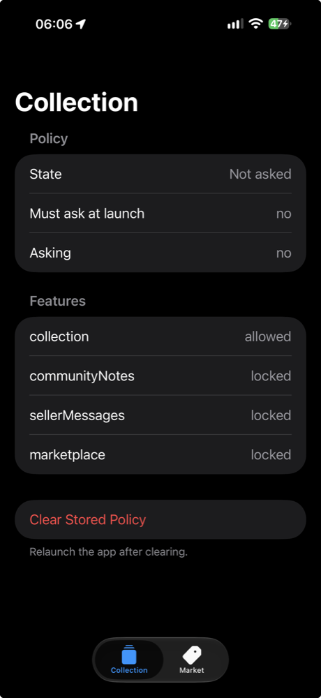
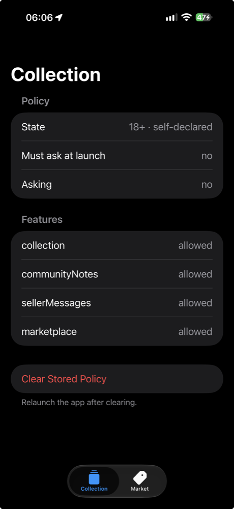

# DeclaredAgeRangeDemo

Sample app for [The Thing That Should Not Be: Age Gating With Declared Age Range](https://www.wesleymatlock.com/declared-age-range-age-gating-without-birthdays/).

It age-gates a record-collection app with Apple's Declared Age Range API instead of a birthday. The code in `Crate/AgePolicy.swift`, `Crate/AgeGate.swift`, and `Crate/CrateApp.swift` is the code from the post. The rest is there so you can see what's happening while it runs.

## Requirements

- Xcode 27 and Swift 6
- iOS 26.0 or later
- A real device to get real answers. The Simulator only exercises the failure path.

## Running it

1. Open `DeclaredAgeRangeDemo.xcodeproj`.
2. Under Signing & Capabilities for the `Crate` target, pick your team and change the bundle ID. Make sure the Declared Age Range capability is on.
3. On the device, turn on Developer Mode, then go to Settings, Developer, Sandbox Apple Account. Tap Manage and pick Age Assurance to choose a scenario.
4. Run the app. The Collection tab shows the current policy and which features it allows. The Market tab is gated to adults.
5. Between scenarios, tap Clear Stored Policy and relaunch.

Before and after sharing an 18+ self-declared range from the sandbox:

  
  

To print the raw API results to the console, enable the `-probe` launch argument in the scheme.

## What's in it

- `AgePolicy.swift`: age tiers, the policy type, and the feature gate. No UI and no device needed.
- `AgeGate.swift`: when to ask, error handling, and what gets persisted.
- `CrateApp.swift`: the app, the launch check, and the `AgeGated` view.
- `SignificantChanges.swift`: the PermissionKit and StoreKit pieces for significant updates. These need iOS 26.2.
- `Harness.swift` and `Probe.swift`: the status screen and the `-probe` diagnostics.
- `CrateTests/AgePolicyTests.swift`: Swift Testing tests for the policy.

The project is generated from `project.yml` with [XcodeGen](https://github.com/yonaskolb/XcodeGen). The generated project is committed, so you don't need XcodeGen to build it.
